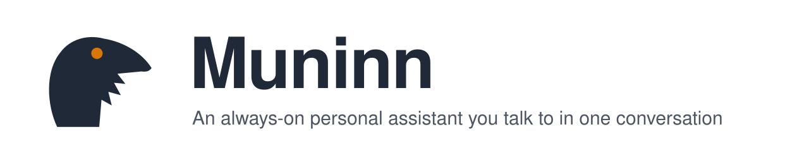

<picture>
  <source media="(prefers-color-scheme: dark)" srcset="https://raw.githubusercontent.com/imaknas/muninn/main/assets/logo/banner-en-dark.svg">
  
</picture>

<p align="center">
  <a href="https://github.com/imaknas/muninn/actions/workflows/ci.yml"></a>
  <a href="https://pypi.org/project/muninn-ai/"></a>
  <a href="https://github.com/imaknas/muninn/blob/main/LICENSE"></a>
</p>

<p align="center">English · <a href="https://github.com/imaknas/muninn/blob/main/README.zh-TW.md">繁體中文</a></p>

Muninn is a personal assistant that runs on your own computer, and that you talk to in one conversation, on your
phone or in a browser. It keeps track of what you are working towards, notices when you drift from the plan, and
brings up only what matters, with what to do next. Whatever it does on its own can be undone; anything that cannot be
taken back waits for your yes.

## Install

On macOS or Linux, this installs Muninn, starts it in the background and opens its setup page:

```bash
curl -fsSL https://raw.githubusercontent.com/imaknas/muninn/main/install.sh | sh
```

Or with [uv](https://docs.astral.sh/uv/):

```bash
uv tool install muninn-ai
muninn init && muninn serve
```

On a NAS or a server: `docker compose up -d` (see [compose.yaml](https://github.com/imaknas/muninn/blob/main/compose.yaml)). More in [docs/install.md](https://github.com/imaknas/muninn/blob/main/docs/install.md).

## Getting started

1. On the setup page, pick a model and paste its key: Claude, any service with an OpenAI-style API, or a local model
   with Ollama.
2. Start talking to it, right there in the browser.
3. For your phone, open Settings → Pair a phone. With Tailscale on the computer, Muninn gives itself an HTTPS address
   on your tailnet; scan the code.

`muninn upgrade` moves to the latest release, `muninn check` says what in the settings cannot work as written, and
`muninn backup DIR` copies your data.

## What it does

- **One conversation.** Tell it what happened, ask it things, answer what it asks. No forms.
- **Goals and deadlines, per part of your life.** It measures progress from what it observes and nudges you when you
  fall behind, within daily limits and quiet hours.
- **A morning brief, an evening summary and a weekly reflection.**
- **Mail and calendar.** Google: it reads mail, saves reply drafts and blocks time in a calendar of its own. Microsoft
  365: it reads. It never sends mail or answers an invitation for you.
- **Job applications.** It prepares each one from the posting and your documents; with the `autofill` extra
  installed it also fills in Greenhouse forms, for you to send with one tap.
- **Your coding projects.** A project can hand it to-dos and questions only you can settle
  ([Principal Handoff](https://github.com/imaknas/muninn/blob/main/src/muninn/contracts/records.v2.md)), and with a session runner (such as
  [agent-hub](https://github.com/imaknas/agent-hub)) a conversation can be lent to a project's own session.
- **English or Traditional Chinese**, throughout.

## Privacy

Muninn runs on your machine, and what it knows stays in its `data/` folder. One setting decides where models run:
`cloud` sends every request to the cloud model you chose; `privacy` keeps work and anything unattributed on a local
model, and gives the cloud only whitelisted fields. You can cap what cloud models cost per day, and every device has to
be paired. Details in [docs/privacy.md](https://github.com/imaknas/muninn/blob/main/docs/privacy.md); vulnerabilities go to [SECURITY.md](https://github.com/imaknas/muninn/blob/main/SECURITY.md).

## Documentation

| | |
|---|---|
| Install, upgrade, Docker, HTTPS for your phone | [docs/install.md](https://github.com/imaknas/muninn/blob/main/docs/install.md) |
| Domains, goals, what it observes, what it does for you | [docs/how-it-works.md](https://github.com/imaknas/muninn/blob/main/docs/how-it-works.md) |
| Where models run and what leaves the machine | [docs/privacy.md](https://github.com/imaknas/muninn/blob/main/docs/privacy.md) |
| Interfaces for other systems | [src/muninn/contracts](https://github.com/imaknas/muninn/tree/main/src/muninn/contracts) |
| Developing, testing, releasing | [CONTRIBUTING.md](https://github.com/imaknas/muninn/blob/main/CONTRIBUTING.md) |
| What changed in each release | [CHANGELOG.md](https://github.com/imaknas/muninn/blob/main/CHANGELOG.md) |

## License

[Apache-2.0](https://github.com/imaknas/muninn/blob/main/LICENSE)
